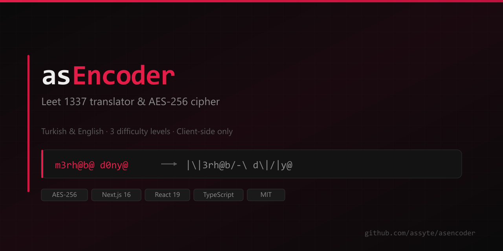

<div align="center">



</div>

---

# asEncoder

**Leet 1337 translator & AES-256 cipher — Turkish & English**

Türkçe ve İngilizce metni Leet 1337'ye üç farklı zorluk seviyesinde çeviren ve
tarayıcıda AES-256 ile şifreleyen tek sayfalık bir araç. Sunucu yok, hesap yok,
veri gönderimi yok.

[](https://github.com/assyte/asencoder/actions/workflows/ci.yml)
[](LICENSE)
[](https://nextjs.org)
[](https://www.typescriptlang.org)

[Türkçe](#türkçe) · [Features](#features) · [Demo](#demo) · [Quick Start](#quick-start) · [Architecture](#architecture) · [Security](#security) · [Roadmap](#roadmap) · [License](#license)

---

## Why asEncoder?

İnternetteki Leet çeviriciler çoğunlukla oyuncak. Metni çevirir, bırakırlar.
**asEncoder** ise dil dönüşümünü ve gizliliği tek bir iş olarak ele alır.

- 🇹🇷 Türkçe **ve** İngilizce (tam diyakritik desteği: `ç ğ ı ö ş ü`)
- 🎯 **Üç zorluk seviyesi** — basit (okunur), orta (dengeli), zor (kaotik)
- 🔐 **AES-256-GCM** şifreleme, PBKDF2 ile anahtar türetme (100.000 iterasyon)
- 🌗 Açık ve koyu tema, `localStorage`'da saklanır
- 📄 Düz metin (`.txt`) dosya içe / dışa aktarma
- ⚡ Sayfa yüklendikten sonra **hiçbir ağ isteği yapılmaz**

---

## Features

| Özellik | Açıklama |
|---|---|
| **Üç Leet seviyesi** | Her seviyenin kendi sözlüğü var; zor mod her karakter için rastgele alternatif seçer. |
| **Aynı anda üç varyasyon** | Tek kaynak metinden basic / medium / hard çıktıları yan yana. |
| **Kelime kısaltmaları** | Yaygın Türkçe ve İngilizce kelimeler (`the → 7h3`, `bir → b1r`) orta seviyeden itibaren uygulanır. |
| **Çift çeviri koruması** | Kısaltmalar (`7h3`) yeniden harf harf işlenmez; `the → 7h3` asla `7h15` olmaz. |
| **Kelime sınırı doğruluğu** | `there` kelimesi `the` kısaltmasına yakalanmaz — tam kelime eşleşmesi. |
| **AES-256-GCM** | Endüstri standardı kimlik doğrulamalı şifreleme. 12 bayt IV, 16 bayt salt, 16 bayt auth tag. |
| **PBKDF2-SHA256** | 100.000 iterasyon — kaba kuvvet saldırılarını yavaşlatır. |
| **Şifre gücü göstergesi** | Yazarken canlı entropi geri bildirimi. |
| **Göster / gizle** | Tek tıkla şifreyi göster, otomatik olarak asla açık gelmez. |
| **`.txt` yükle / indir** | Dosyayı sürükleyip bırak, çıktıyı indir. |
| **Tema değiştirme** | Açık/koyu; ilk yüklemede `prefers-color-scheme`'e uyar, sonra `localStorage`'dan okur. |
| **Tema flaş önleme** | Tema, React hydrate olmadan önce `<head>` içindeki inline script ile uygulanır. |
| **Duyarlı düzen** | Dashboard mobilde tek sütuna düşer. |
| **Erişilebilirlik** | Semantik başlıklar, ARIA etiketleri, klavye navigasyonu. |

---

## Demo

Uygulamayı çalıştırın, bir şeyler yazın, **Leet'e çevir**'ye basın, sonra bir şifre ile kilitleyin.

```
Input  :  Merhaba dünya! Bugün hava çok güzel.
          ─────────────────────────────────────────────
Basic  :  M3rh@b@ d0ny@! 8ug0n h4v4 ç0k 9v3z3l.
Medium :  M3rh#b# d#ny#! 8u9#n h4v4 ç0k 9v3z3|.
Hard   :  |\/\|3rh@b/-\ d\\|/|y@! 8u9\|-\ h4v4 ç0|< 9v3z3|3   (rastgele — her seferinde değişir)
          ─────────────────────────────────────────────
Encrypt →  [base64 şifreli blok, ≈ girdinin 1,4 katı]
Decrypt →  şifre doğruysa orijinal metne döner.
```

> Zor seviye çıktısı **her render'da farklıdır** çünkü karakter seçimi rastgeledir.

---

## Quick Start

Gereksinim: **Node.js 18.17+**

```bash
# 1. Klonla
git clone https://github.com/assyte/asencoder.git
cd asencoder

# 2. Bağımlılıkları kur
npm install

# 3. Geliştirme sunucusu
npm run dev      # → http://localhost:3000

# 4. Üretim derlemesi (statik export)
npm run build    # → out/
```

Ortam dosyası, API anahtarı veya veritabanı gerekmez.

### Komutlar

| Komut | Açıklama |
|---|---|
| `npm run dev` | Geliştirme sunucusu |
| `npm run build` | Üretim derlemesi → `out/` (statik HTML) |
| `npm run preview` | Üretim çıktısını yerelde sunar |
| `npm run lint` | ESLint 9 (flat config) |
| `npm run type-check` | TypeScript denetimi (`tsc --noEmit`) |
| `npm run check` | type-check + lint + build zinciri |

### Deploy

Çıktı **tamamen statik** — `output: "export"` ayarı sayesinde sunucu katmanı
hiç oluşturulmuyor. Bu yüzden herhangi bir statik host'a deploy edilebilir:

- **Vercel** — doğrudan bağla, framework otomatik algılanır
- **Cloudflare Pages** — build: `npm run build`, çıktı dizini: `out`
- **Netlify** — build: `npm run build`, publish: `out`
- **GitHub Pages** — Actions artifact'ı veya `out/` klasörü
- **Nginx / Caddy / S3** — dosyaları kopyala, yapılandırma gerekmez

> Static export sayesinde sunucu tarafı saldırı yüzeyi **sıfırdır**.
> Server Actions, middleware ve RSC cache gibi bileşenler hiç oluşturulmaz.

---

## Architecture

```
app/
├── layout.tsx           # Inter + JetBrains Mono fontları, tema başlatma scripti
├── page.tsx             # Tek sayfalık dashboard (state yönetimi)
├── icon.png             # Favicon
└── globals.css          # Tema değişkenleri, 3D bileşen stilleri

components/
├── HackerBackground.tsx # Izgara + karakter görseli arka planı
├── ThemeToggle.tsx      # Animasyonlu açık/koyu düğmesi
├── TranslatorPanel.tsx  # Sol: metin girişi, dil, seviye
├── OutputPanel.tsx      # Sağ: üç varyasyon + sekmeler
├── CryptoPanel.tsx      # AES şifrele / çöz
├── FileHandler.tsx      # .txt yükle / indir
├── NeuButton.tsx        # 3D düğme (primary / secondary / ghost)
└── Toast.tsx            # Bildirim sistemi

lib/
├── leet/
│   ├── basic.ts         # Temel harf dönüşümleri
│   ├── medium.ts        # Orta sözlük + kelime kısaltmaları
│   ├── hard.ts          # Zor sözlük (rastgele alternatifler)
│   ├── translator.ts    # translateToLeet() çekirdek mantığı
│   └── index.ts
├── crypto/
│   ├── aes.ts           # AES-GCM + PBKDF2 sarmalayıcı
│   └── utils.ts         # Dışa aktarılan yardımcılar
└── index.ts
```

### Data Flow

```
                     ┌─────────────────────┐
   kullanıcı metni → │  splitWordsAndSeparators()  │ → kelime + ayraç parçaları
                     └──────────┬──────────────────┘
                                │
                ┌───────────────┴───────────────┐
                ↓                               ↓
    ┌───────────────────────┐    ┌──────────────────────────┐
    │  kısaltma var mı?     │    │  yoksa harf harf çeviri  │
    │  (the → 7h3)          │    │  (translateChar)         │
    └───────────┬───────────┘    └────────────┬─────────────┘
                └───────────────┬──────────────┘
                                ↓
                    ┌───────────────────────┐
                    │   Leet metni          │
                    └───────────┬───────────┘
                                ↓
        ┌───────────────────────────────────────────┐
        │  Web Crypto API                          │
        │  1. PBKDF2(password, random salt) → key  │
        │  2. AES-GCM(key, random IV, metin)       │
        │  3. [salt ‖ IV ‖ ciphertext+tag] → base64│
        └───────────────────┬───────────────────────┘
                            ↓
                    ┌───────────────────────┐
                    │  Şifreli çıktı        │
                    └───────────────────────┘
```

### Translation Engine

Çeviri motoru iki aşamalı çalışır ve bu sıralama **kritiktir**:

1. **Kelime kısaltmaları** sözlükteki kısaltma zaten leet formundadır
   (`the → 7h3`). Eğer önce uygulanıp sonra tüm metin harf harf çevrilirse,
   `7h3` yeniden işlenir ve bozulur.
2. Bu yüzden metin önce **kelime + ayraç** parçalarına bölünür. Her kelime için:
   kısaltma varsa **olduğu gibi** eklenir, yoksa harf çevirisi uygulanır.

Bu yaklaşım iki tuzağı aynı anda engeller:

| Tuzak | Durum | Nasıl engelleniyor |
|---|---|---|
| Çift çeviri | `the` → `7h3` → `7h35` | Kısaltmalar harf çevirisinden muaftır |
| Alt-kelime eşleşme | `there` → `7h3r3` | Parça bazlı tam kelime eşleşmesi |

### Tech

- **Next.js 16** (App Router, Turbopack) + **React 19** + **TypeScript 5** (strict)
- **Tailwind CSS 3** — CSS değişkeni tabanlı tema
- **ESLint 9** — flat config (`eslint.config.mjs`)
- **Web Crypto API** — AES için üçüncü taraf kütüphane yok
- **Inter** + **JetBrains Mono** — `next/font/google` üzerinden
- **Static export** (`output: "export"`) — sunucu katmanı yok

---

## Security

asEncoder tek bir ilke üzerine kurulu: **veriniz makinenizden asla çıkmaz.**

- Tüm şifreleme tarayıcıda `window.crypto.subtle` ile yapılır
- Yazdığınız şifre **PBKDF2-SHA256** ile anahtara dönüştürülür
  (100.000 iterasyon), sonra bellekten hemen düşürülür
- Salt, IV ve auth tag şifreli metinle birleştirilip base64'e kodlanır —
  depolamaya veya panoya giden tek şey budur
- **Telemetri, analitik, çerez veya sayfa yüklendikten sonra ağ isteği yok**
- Şifre asla `localStorage`'a yazılmaz — yalnızca tema tercihi saklanır

### Cipher Format

```
┌──────────────┬──────────────┬───────────────────────┬──────────────┐
│  16B salt    │  12B IV      │       ciphertext      │  16B tag     │
└──────────────┴──────────────┴───────────────────────┴──────────────┘
                    └──────────── hepsi base64 ────────────┘
```

- **Salt** (16 bayt) — `crypto.getRandomValues` ile her seferinde yeni.
  Aynı şifre iki kez aynı metni şifrelesin bile çıktılar farklı olur.
- **IV** (12 bayt) — GCM için önerilen boyut, her çağrıda yeniden üretilir.
- **Tag** (16 bayt) — AES-GCM'in kimlik doğrulama etiketi. Şifre yanlışsa
  çözme `OperationError` ile başarısız olur; sahte düz metin dönemez.

Şifrenizi kaybederseniz **veri kurtarılamaz** — bu bilinçli bir tasarım kararıdır.

### Bağımlılık denetimi

```bash
npm audit --omit=dev --audit-level=high   # → found 0 vulnerabilities
```

Yalnızca *çalışma zamanı* bağımlılıkları denetlenir. `--omit=dev` kullanılmasının
sebebi: kalan uyarıların tamamı build-time araçlardan gelir (`chokidar`,
`fast-glob`, `glob`) ve tarayıcıya paketlenmez.

Ek olarak `output: "export"` ile uygulama tamamen statik HTML'e dönüşür —
Server Actions, middleware, RSC cache gibi sunucu tarafı bileşenler hiç
oluşturulmaz, dolayısıyla saldırı yüzeyi sıfırdır.

---

## Türkçe

**asEncoder**, Türkçe ve İngilizce metni Leet 1337'ye üç farklı zorlukta
çeviren, ardından tarayıcınızda AES-256 ile şifreleyen tek sayfalık bir araçtır.

- **Basit** — kolay okunur tek harf dönüşümleri (`e → 3`, `a → @`)
- **Orta** — çoklu alternatifler + yaygın kelime kısaltmaları (`the → 7h3`)
- **Zor** — rastgele seçilen alternatifler, çözülebilirliği neredeyse imkânsız

Türkçe karakterler (`ç ğ ı ö ş ü`) hem angilizce harflerle hem de
kendine ait leet karşılıklarıyla işlenir. Kelime kısaltmaları orta ve zor
seviyelerde devreye girer ve **çift çeviri koruması** sayesinde bozulmaz:
`the` hiçbir zaman `7h15` olmaz.

Şifreleme tamamen istemci tarafında çalışır; parolanız hiçbir zaman sunucuya
gitmez. Açık/koyu tema desteği, `.txt` dosya yükleme/indirme, kopyalama ve
karşılaştırma önizlemesi dahildir.

Geliştirici: **[@assyte](https://github.com/assyte)** · MIT lisanslı ·
katkılara memnuniyetle karşı verilir.

---

## Roadmap

- [x] Türkçe ↔ Leet çeviri (3 seviye)
- [x] AES-256-GCM şifreleme / çözme
- [x] Şifre gücü göstergesi
- [x] `.txt` içe / dışa aktarma
- [x] Açık/koyu tema (flash olmadan)
- [x] Leet → düz metin geri çeviri sözlüğü (`REVERSE_LEET`)
- [ ] Kelime kısaltma sözlüğünü genişlet (yüzlerce kelime)
- [ ] Web Worker ile büyük metinlerde performans
- [ ] Çeviri geçmişini kopyalayabilir çıktı formatı
- [ ] PWA — çevrimdışı kullanım

---

## Contributing

Katkılar memnuniyetle karşılanır.

```bash
git clone https://github.com/assyte/asencoder.git
cd asencoder
npm install
npm run dev
```

Değişiklik göndermeden önce `npm run check` temiz geçmeli
(type-check + lint + build). CI aynı zinciri otomatik çalıştırır ve
statik çıktının üretildiğini doğrular.

---

## License

[MIT](./LICENSE) © 2026 [assyte](https://github.com/assyte)